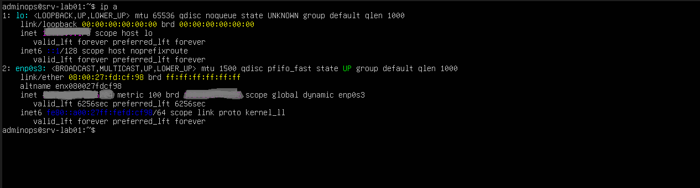
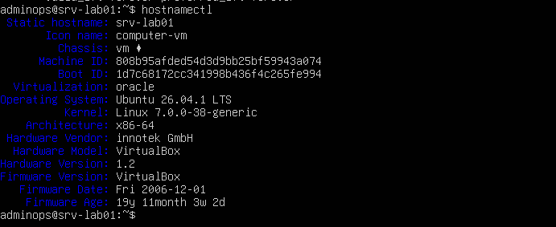

# Lab Setup

## Environment
- Hypervisor: VirtualBox 7.2.20
- Guest OS: Ubuntu Server 26.04.1 LTS
- Resources: 2 vCPU, 2 GB RAM, 25 GB disk
- Network: Bridged adapter
- Hostname: srv-lab01
- Admin user: adminops

## Steps
1. Created VM `srv-lab01` in VirtualBox (Expert Mode, 2 CPUs, bridged network)
2. Installed Ubuntu Server with OpenSSH
3. Ran `sudo apt update && sudo apt upgrade -y` (23 packages, new kernel)
4. Rebooted and verified the new kernel with `uname -r`
5. Took VM snapshot `clean-install`
6. Connected from the host using SSH

## Verification

